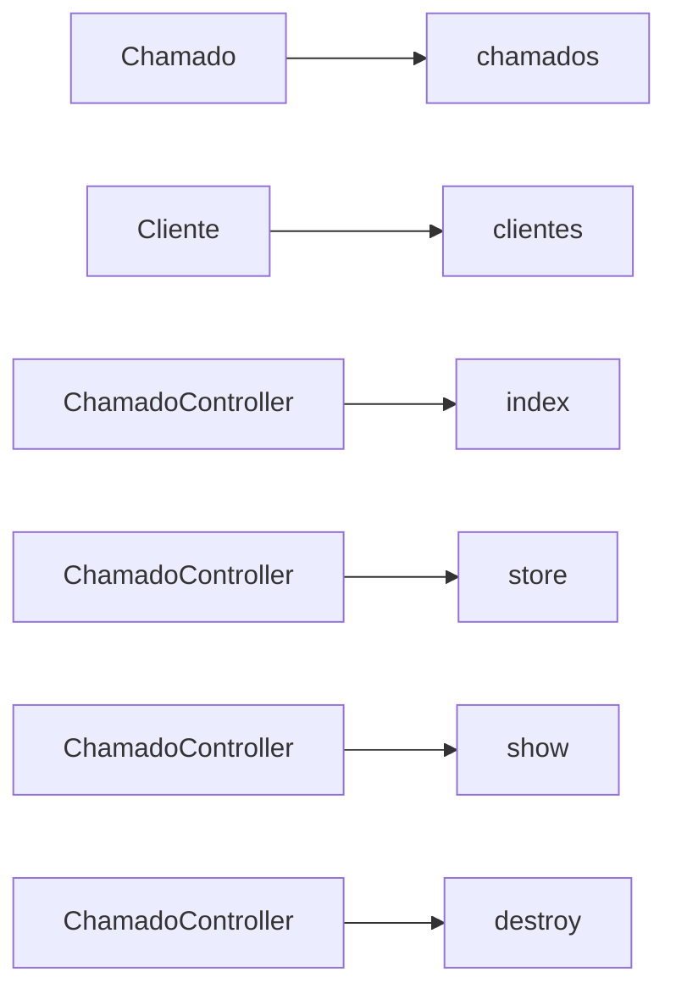

# Mapa da aplicação — acme-chamados

> Gerado por `croqui 0.1.1` em 21/10/2026, **sem IA e sem rede**, a partir da estrutura do repositório. Nível 3 de 3 · ~389 tokens.
>
> **Contém:** nomes de classe, rota, tabela, job e comando deste repositório; contagens; e relações derivadas de convenção do framework.
>
> **Não contém:** valor de configuração, segredo, credencial, conteúdo de `.env`, literal de código, nem qualquer linha de código-fonte.
>
> **Recusados na leitura:** `.env.example`.
>
> **symlinks ignorados: 0** (nunca seguidos).
>
> O grafo é derivado de **convenção e de import, em nível de módulo**: **não é call graph** e não vem de execução.

## 1. O que é

- Camadas detectadas: laravel, generico
- Stack: laravel, php
- Rotas: 5 · Controladores: 1 · Entidades: 2 · Jobs: 1 · Comandos: 0 · Eventos: 0

## 2. Pontos de entrada

- `cli` → `artisan`
- `http` → `routes/api.php`

## 3. Rotas

| Verbo | Caminho | Controlador | Método |
|---|---|---|---|
| GET | `/chamados` | `ChamadoController` | `index` |
| POST | `/chamados` | `ChamadoController` | `store` |
| GET | `/chamados/{id}` | `ChamadoController` | `show` |
| DELETE | `/chamados/{id}` | `ChamadoController` | `destroy` |
| GET | `/saude` | — | — |

Controladores declarados: `ChamadoController`

## 4. Entidades e tabelas

| Classe | Tabela | Campos declarados |
|---|---|---|
| `Chamado` | `chamados` | 4 |
| `Cliente` | `clientes` | 2 |

## 5. Jobs, comandos e eventos

- Jobs: `NotificaChamado`
- Comandos: _nenhum_
- Eventos: _nenhum_

## 6. Pastas (agregado)

| Pasta | Arquivos |
|---|---|
| `.` | 2 |
| `app/Models` | 2 |
| `app/Http/Controllers` | 1 |
| `app/Jobs` | 1 |
| `config` | 1 |
| `database/migrations` | 1 |
| `routes` | 1 |

## 7. Grafo

Derivado de convenção, em nível de módulo. Não é call graph.

